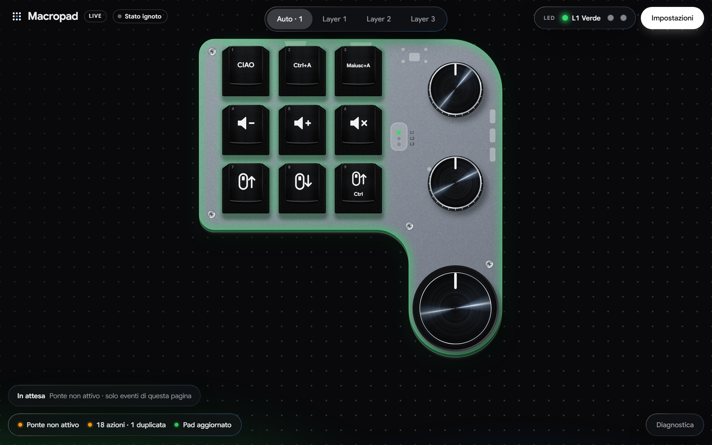
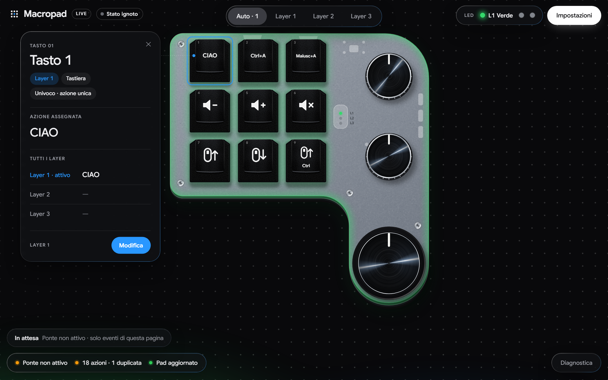
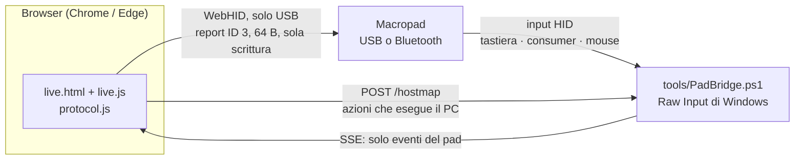

<div align="center">

# Macropad Studio

**Vista live e configuratore per il macropad generico a 9 tasti + 3 manopole con Bluetooth (USB `1189:8833`).**
Niente software del produttore, niente installazione, nessuna dipendenza: una pagina web che parla con il pad via WebHID,
più un piccolo ponte opzionale per Windows che distingue il pad dalla tua tastiera.

[](app/test/protocol.test.js)
[](LICENSE)


[English](README.md) · [Protocollo](docs/PROTOCOL.md) · [Hardware](docs/HARDWARE.md) · [Diario di sviluppo](docs/DEVELOPMENT-LOG.md)



</div>

---

## Perché

I macropad economici "MINI KeyBoard" arrivano con uno strumento di configurazione solo per Windows, vecchio e scomodo, che non
mostra cosa sta facendo il dispositivo. Questo progetto ricostruisce il protocollo di configurazione USB della variante
`1189:8833` e ne fa un'alternativa moderna:

* vedi il pad **dal vivo** (ogni tasto premuto, ogni manopola ruotata o cliccata, il layer attivo);
* **programmi** ogni controllo di ogni layer dal browser, con l'invio delle sole modifiche;
* sai *quale* controllo è scattato anche quando due producono la stessa scorciatoia;
* tutto documentato, testato e senza dipendenze.

> **Non affiliato al produttore.** Progetto indipendente della comunità. Non include binari né codice del produttore.

## Il dispositivo

| | |
|---|---|
| Controlli | 9 tasti meccanici, 3 encoder rotativi con pulsante (ogni manopola = ↺ / premi / ↻) → **18 controlli** |
| Layer | 3 (si cambia col pulsante *Layer* sulla scheda), colore ed effetto RGB per layer |
| Azioni | macro da tastiera (fino a 18 pressioni, con pause), tasti media, pulsanti e rotella del mouse |
| Collegamento | USB-C (`VID 1189 / PID 8833`) e Bluetooth LE (`MINI_KEYBOARD`), batteria LiPo, interruttore ON/OFF |
| SoC | Jieli (Zhuhai Jieli, Company ID BLE `0x05D6`); serigrafia della scheda `ANXIN-@9KEY_3KNOB` |
| Programmazione | **Solo USB.** Il Bluetooth trasporta i tasti ma non permette di configurare il pad (provato) |

Altri dispositivi della stessa famiglia OEM (es. `1189:8840`, `1189:8842`, `1189:8890`) usano un formato di pacchetto molto
simile ma **non** sono stati provati con questo progetto.

## Funzioni

* **Vista live** – il pad è disegnato in scala (sagoma ricavata dalle foto del PCB reale): i tasti si abbassano, le manopole
  girano, layer attivo e colore LED seguono il dispositivo. Funziona anche in background e in Bluetooth, tramite il ponte.
* **Configuratore dentro la vista live** – clic su un controllo, poi *Modifica*:
  tastiera (registra dalla tastiera o dal pad, scegli un tasto con i modificatori, scrivi un testo, inserisci pause),
  media, mouse, nessuna azione o disattivato. Tre layer per controllo, colore ed effetto LED per layer.
* **Comportamento a tasto tenuto**, per controllo – *ripeti finché è premuto* oppure *una volta per pressione* (volume, frecce, lettere…).
* **Riconoscimento univoco** – quando due controlli emetterebbero lo stesso evento l'app "firma" automaticamente solo quelli
  (una coppia F13–F21 invisibile, oppure un usage consumer riservato che funziona anche in Bluetooth): il layer non viene mai scambiato.
* **Azioni eseguite dal PC** – le azioni media/mouse duplicate le esegue il ponte sul PC, una nativa per gruppo.
* **Invio guidato** – la pillola "Da inviare al pad" mostra quali pacchetti differiscono da ciò che il pad ha già; un solo pulsante li scrive.
* **Importa / esporta** i profili in JSON, con i pacchetti esadecimali esatti nei *dettagli tecnici*.
* **Interfaccia adattiva** – vetro smerigliato, tema chiaro e scuro, da schermi di 360 px a ultrawide.

<div align="center">

</div>

## Avvio rapido (Windows 10/11)

Requisiti: **Chrome o Edge** (WebHID), **Python 3** (server di file statici) e il macropad collegato con il cavo USB.
Il ponte usa Windows PowerShell 5.1, già presente in Windows. Node.js ≥ 18 serve solo per i test.

```bat
start.cmd
```

Si aprono tre cose: la finestra del ponte, un server web locale su `127.0.0.1:5173` e `http://localhost:5173/live.html` nel browser. Poi:

1. **Clic su un tasto o una manopola** per vedere cosa fa in ogni layer, **Modifica** per cambiarla.
2. **Collega e invia** (serve il cavo USB) quando la pillola *Da inviare al pad* segnala modifiche.
3. Il pallino accanto a **LIVE** mostra il collegamento: verde USB, blu wireless, rosso non collegato.

Senza ponte: servi la cartella `app/` con un qualunque server statico (`python -m http.server 5173 --directory app`) e apri
`live.html`; puoi comunque configurare il pad, ma la pagina non distingue gli eventi del pad da quelli della tastiera.

## Come funziona



* Il pad è **in sola scrittura**: il protocollo non ha un comando di lettura, quindi il profilo salvato nel browser
  (esportabile in JSON) è l'unica copia della tua configurazione.
* **Raw Input** dice *da quale dispositivo* arriva un evento, così i tasti del pad non si confondono con la tastiera.
  Gli eventi di tutti gli altri dispositivi vengono scartati prima di leggerne il contenuto; il ponte ascolta solo su `127.0.0.1`
  e accetta richieste solo dall'origine dell'app (`localhost:5173`).
* Il pacchetto di configurazione è `FE <controllo> <layer> <tipo> <pausa> … <n> (<modificatore> <tasto>)×≤18`, inviato come
  report da 64 byte. Tutto ciò che è stato misurato su hardware – numerazione dei controlli, persistenza, modi LED, cosa fa Windows
  con ogni usage, risultati sul Bluetooth – è in [`docs/PROTOCOL.md`](docs/PROTOCOL.md).

## Sicurezza – da leggere

* L'invio **sovrascrive** quel controllo/layer nella memoria del pad. Esporta prima il profilo se ti interessa quello attuale.
* Si scrive solo configurazione (macro, LED). Nulla qui implementa un aggiornamento del firmware.
* Gli strumenti toccano solo dispositivi il cui ID contiene `VID_1189` (e, per il wireless, l'indirizzo BLE del pad): nient'altro viene enumerato o aperto.
* `tools/PadWrite.ps1` è una prova a secco, salvo `-Write -IUnderstand`.
* Software fornito così com'è, senza garanzie (vedi [LICENSE](LICENSE)). È stato verificato su **un** esemplare fisico.

## Struttura del repository

| Percorso | Cos'è |
|---|---|
| [`app/`](app/README.md) | L'app web: `live.html`, `live.js`, `protocol.js`, font, profilo di prova, test (`npm test` / `node app/test/protocol.test.js`) |
| [`tools/`](tools/README.md) | `PadBridge.ps1` (ponte Raw Input → SSE), `PadWrite.ps1` e `profile-frames.js` (scrittura da riga di comando), `RawInputPad.ps1` (cattura passiva) |
| [`tools/research/`](tools/research/README.md) | Strumenti di analisi in sola lettura (disassemblatore IL, sonde HID/USB/GATT) |
| [`docs/`](docs/) | [`PROTOCOL.md`](docs/PROTOCOL.md) (fonte di verità), [`HARDWARE.md`](docs/HARDWARE.md), [`BLUETOOTH.md`](docs/BLUETOOTH.md), [`ANALYSIS.md`](docs/ANALYSIS.md), [`DESIGN.md`](docs/DESIGN.md), [`DEVELOPMENT-LOG.md`](docs/DEVELOPMENT-LOG.md), foto del PCB |
| [`start.cmd`](start.cmd) | Avvio con un clic: ponte + server locale + browser |

## Sviluppo

```bash
node app/test/protocol.test.js        # 54 test: esempi del protocollo, piano di firma, azioni dal PC, coerenza live.js ↔ protocol.js
node tools/profile-frames.js app/profiles/diagnostico-layer1.json   # profilo → pacchetti, senza dispositivo
```

* `app/protocol.js` è puro (niente DOM, niente HID) ed è l'unica fonte per la codifica. Un piccolo blocco è duplicato di proposito
  in `live.js` (`HOSTED-BEGIN … HOSTED-END`): un test li confronta, quindi vanno cambiati insieme.
* Le pull request che toccano il protocollo dovrebbero includere i pacchetti esadecimali e, se possibile, cosa è stato osservato su un pad reale.
* [`CLAUDE.md`](CLAUDE.md) contiene brevi note di lavoro per gli agenti di programmazione AI (e una mappa del repository).

## Roadmap

- [ ] Verificare su hardware l'opzione *ripeti a tasto tenuto* per media/mouse (la ripetizione del ponte è provata solo in isolamento).
- [ ] Riconoscimento più rapido di pressioni alternate veloci con macro firmate (misurare la latenza; una modalità a bassa latenza è citata nel diario).
- [ ] Interfaccia e documentazione in inglese (testi dell'interfaccia e documenti di approfondimento sono oggi in italiano).
- [ ] Supporto nativo per Windows, macOS e Linux: un ponte per ogni sistema (oggi il ponte per dispositivo è solo Windows; la programmazione è semplice WebHID) e pacchetto desktop (guscio Electron; oggi il ponte accetta solo l'origine `http://localhost:5173`).
- [ ] Rinominare i layer (preset): un nome per layer, salvato nel profilo esportato (il pad non ha dove memorizzarlo).
- [ ] Grafica migliore delle macro sui tasti: più icone e testo più curato per scorciatoie lunghe e testi digitati.
- [ ] Libreria di macro già pronte: scorciatoie comuni per sistema (es. Win+V appunti, Win+D desktop, Alt+Tab cambio app, Win+Shift+S screenshot; gli equivalenti macOS e Linux), ognuna selezionabile come azione unica con la propria icona. Ogni sistema offre solo quelle compatibili.
- [ ] Prove su altri dispositivi della stessa famiglia OEM.

## Crediti e lavori precedenti

* [kriomant/ch57x-keyboard-tool](https://github.com/kriomant/ch57x-keyboard-tool) – strumento open source per i modelli affini `1189:8840/8842/8890`; da qui sono partite le ipotesi sui modi LED.
* [rOzzy1987/MacroPad](https://github.com/rOzzy1987/MacroPad) (GPL-3.0), [Probler-Yt/MacroPad](https://github.com/Probler-Yt/MacroPad), [jonnytest1/minikeyboard](https://github.com/jonnytest1/minikeyboard) – riferimenti indipendenti sul formato dei pacchetti. Nessun loro codice è incluso.
* [Google Sans](app/fonts/GoogleSans-LICENSE.txt) è incluso con licenza SIL Open Font License 1.1.

## Licenza

[MIT](LICENSE). I nomi di prodotto e i marchi appartengono ai rispettivi proprietari e sono usati solo per identificare l'hardware con cui il progetto interagisce.
