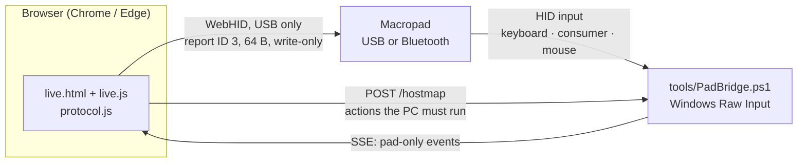

<div align="center">

# Macropad Studio

**A live view and configurator for the generic 9-key + 3-knob Bluetooth macropad (USB `1189:8833`).**
No vendor software, no installer, no dependencies: one web page that talks to the pad over WebHID,
plus a small optional Windows bridge that tells the pad apart from your keyboard.

[](https://github.com/Leo00703/macropad-studio/actions/workflows/test.yml)
[](LICENSE)


[Italiano](README.it.md) · [Protocol](docs/PROTOCOL.md) · [Hardware](docs/HARDWARE.md) · [Dev log](docs/DEVELOPMENT-LOG.md)


</div>

---

## Why

Cheap "MINI KeyBoard" macropads ship with a Windows-only configuration tool that is old, clunky and cannot show you what the
device is doing. This project reverse-engineers the USB configuration protocol of the `1189:8833` variant and builds a
modern replacement:

* see the pad **live** (every key press, every knob click and turn, the active layer);
* **program** every control of every layer from the browser, with a diff-based "send to pad" flow;
* know *which* control fired even when two of them produce the same shortcut;
* all of it documented, tested and dependency-free.

> **Not affiliated with the manufacturer.** This is an independent, community project. No vendor binaries or code are included.

## The device

| | |
|---|---|
| Controls | 9 mechanical keys, 3 rotary encoders with push button (each knob = ↺ / press / ↻) → **18 controls** |
| Layers | 3 (cycled with the *Layer* button on the board), per-layer RGB colour + effect |
| Actions | keyboard macros (up to 18 key presses, with pauses), media keys, mouse buttons / wheel |
| Connection | USB-C (`VID 1189 / PID 8833`) and Bluetooth LE (`MINI_KEYBOARD`), LiPo battery, ON/OFF slider |
| SoC | Jieli (Zhuhai Jieli, BLE company ID `0x05D6`); board silkscreen `ANXIN-@9KEY_3KNOB` |
| Programming | **USB only.** Bluetooth carries key presses but cannot be used to configure the pad (tested) |

Other devices of the same OEM family (e.g. `1189:8840`, `1189:8842`, `1189:8890`) use a closely related frame format but have
**not** been tested with this project.

## Features

* **Live view** – the pad is drawn to scale (shape taken from photos of the real PCB); keys sink, knobs turn, the active layer
  and LED colour follow the device. Works in the background and over Bluetooth through the bridge.
* **Configurator inside the live view** – click a control, press *Edit*:
  keyboard (record from the keyboard or from the pad, pick any key with modifiers, type a text, insert pauses),
  media, mouse, none or disabled. Three layers per control, LED colour + effect per layer.
* **Hold behaviour** per control – *repeat while held* or *once per press* (volume, arrows, letters…).
* **Unambiguous recognition** – when two controls would emit the same event the app automatically "signs" only those
  (an invisible F13–F21 pair, or a reserved consumer usage that also survives Bluetooth), so the layer is never mistaken.
* **Host-executed actions** – duplicated media/mouse actions are executed by the bridge on the PC, one native action per group.
* **Send flow** – a pending-changes pill shows exactly which packets differ from what the pad already has; one button writes them.
* **Import / export** profiles as JSON, with exact hex packets in a *technical details* panel.
* **Adaptive UI** – frosted-glass design in light and dark, usable from 360 px phones to ultrawide screens.

<div align="center">

</div>

## Quick start (Windows 10/11)

Requirements: **Chrome or Edge** (WebHID), **Python 3** (static file server) and the macropad connected with the USB cable.
The bridge uses Windows PowerShell 5.1, which ships with Windows. Node.js ≥ 18 is only needed to run the tests.

```bat
start.cmd
```

This opens three things: the event bridge window, a local web server on `127.0.0.1:5173`, and
`http://localhost:5173/live.html` in your browser. Then:

1. **Click a key or knob** to see what it does on each layer, press **Edit** to change it.
2. Press **Connect and send** (needs the USB cable) when the *To send* pill shows pending changes.
3. The dot next to **LIVE** shows how the pad is connected: green USB, blue wireless, red not connected.

> The interface is currently in Italian: *Modifica* = Edit, *Collega e invia* = Connect and send, *Impostazioni* = Settings,
> *Da inviare al pad* = To send, *Diagnostica* = Diagnostics.

No bridge? Serve the `app/` folder with any static server (`python -m http.server 5173 --directory app`) and open
`live.html`; you can still configure the pad, but the page cannot tell the pad's events from your keyboard's.

## How it works



* The pad is **write-only**: the protocol has no read command, so the profile stored in your browser (exportable as JSON)
  is the only copy of your configuration.
* **Raw Input** identifies *which device* produced an input, so key presses of the pad are never confused with your keyboard.
  Events from every other device are discarded before their content is read; the bridge listens on `127.0.0.1` only and accepts
  requests only from the app's own origin (`localhost:5173`).
* The configuration frame is `FE <control> <layer> <type> <delay> … <count> (<modifier> <key>)×≤18`, sent as a 64-byte
  report. Everything that was measured on hardware – control numbering, persistence, LED modes, what Windows does with each usage,
  Bluetooth findings – is in [`docs/PROTOCOL.md`](docs/PROTOCOL.md).

## Safety – please read

* Sending **overwrites** that control/layer in the pad's flash. Export your profile first if you care about the current one.
* Only configuration is written (macros, LEDs). Nothing here implements a firmware update.
* The tools only touch devices whose ID contains `VID_1189` (and, for wireless, the pad's own BLE address); nothing else is enumerated or opened.
* `tools/PadWrite.ps1` is a dry run unless you add `-Write -IUnderstand`.
* This software is provided as is, without warranty (see [LICENSE](LICENSE)). It has been verified on **one** physical unit.

## Repository layout

| Path | What it is |
|---|---|
| [`app/`](app/README.md) | The web app: `live.html`, `live.js`, `protocol.js`, fonts, sample profile, tests (`npm test` / `node app/test/protocol.test.js`) |
| [`tools/`](tools/README.md) | `PadBridge.ps1` (Raw Input → SSE bridge), `PadWrite.ps1` and `profile-frames.js` (CLI writes), `RawInputPad.ps1` (passive capture) |
| [`tools/research/`](tools/research/README.md) | Read-only reverse-engineering helpers (IL disassembler, HID/USB/GATT probes) |
| [`docs/`](docs/) | [`PROTOCOL.md`](docs/PROTOCOL.md) (source of truth), [`HARDWARE.md`](docs/HARDWARE.md), [`BLUETOOTH.md`](docs/BLUETOOTH.md), [`ANALYSIS.md`](docs/ANALYSIS.md), [`DESIGN.md`](docs/DESIGN.md), [`DEVELOPMENT-LOG.md`](docs/DEVELOPMENT-LOG.md), PCB photos |
| [`start.cmd`](start.cmd) | One-click launcher: bridge + local server + browser |

## Development

```bash
node app/test/protocol.test.js        # protocol examples, signing plan, host actions, one-copy guard for live.js
node tools/profile-frames.js app/profiles/diagnostico-layer1.json   # profile → packets, no device needed
```

* `app/protocol.js` is pure (no DOM, no HID) and is the single source of truth for encoding, signing and host-executed actions;
  `live.js` calls it through the global `MP` and must not keep its own copy (a test guards this).
* Pull requests that touch the protocol should include the hex packets and, when possible, what was observed on a real pad.
* [`CLAUDE.md`](CLAUDE.md) holds short working notes for AI coding agents (and a map of the repo).

## Roadmap

- [ ] Verify the *repeat while held* option for media/mouse on real hardware (bridge-side repeat is tested in isolation only). ([#5](https://github.com/Leo00703/macropad-studio/issues/5))
- [ ] Faster recognition of rapid alternating presses with signed macros (measure latency; a low-latency mode is mentioned in the dev log). ([#6](https://github.com/Leo00703/macropad-studio/issues/6))
- [ ] English UI and English documentation (the UI strings and in-depth docs are currently Italian). ([#7](https://github.com/Leo00703/macropad-studio/issues/7))
- [ ] Native support for Windows, macOS and Linux: a bridge per OS (today the per-device input bridge is Windows-only; programming itself is plain WebHID) and desktop packaging (Electron shell; the bridge currently accepts only the `http://localhost:5173` origin). ([#1](https://github.com/Leo00703/macropad-studio/issues/1))
- [ ] Rename layers (presets): a name per layer, stored in the exported profile (the pad has no place to store it). ([#2](https://github.com/Leo00703/macropad-studio/issues/2))
- [ ] Better macro graphics on the keys: a larger icon set and cleaner text rendering for long shortcuts and typed text. ([#3](https://github.com/Leo00703/macropad-studio/issues/3))
- [ ] Ready-made macro library: common shortcuts per OS (e.g. Win+V clipboard, Win+D desktop, Alt+Tab switch app, Win+Shift+S screenshot; the macOS and Linux equivalents), each selectable as a single action with its own icon. Each OS only offers the shortcuts that exist on it. ([#4](https://github.com/Leo00703/macropad-studio/issues/4))
- [ ] Test on other devices of the same OEM family. ([#8](https://github.com/Leo00703/macropad-studio/issues/8))

## Credits and prior art

* [kriomant/ch57x-keyboard-tool](https://github.com/kriomant/ch57x-keyboard-tool) – open-source tool for the sibling `1189:8840/8842/8890` models; the LED mode hypotheses started here.
* [rOzzy1987/MacroPad](https://github.com/rOzzy1987/MacroPad) (GPL-3.0), [Probler-Yt/MacroPad](https://github.com/Probler-Yt/MacroPad), [jonnytest1/minikeyboard](https://github.com/jonnytest1/minikeyboard) – independent references on the frame format. No code from them is included.
* [Google Sans](app/fonts/GoogleSans-LICENSE.txt) is bundled under the SIL Open Font License 1.1.

## License

[MIT](LICENSE). Product names and trademarks belong to their respective owners; they are used here only to identify the hardware this
project interoperates with.
